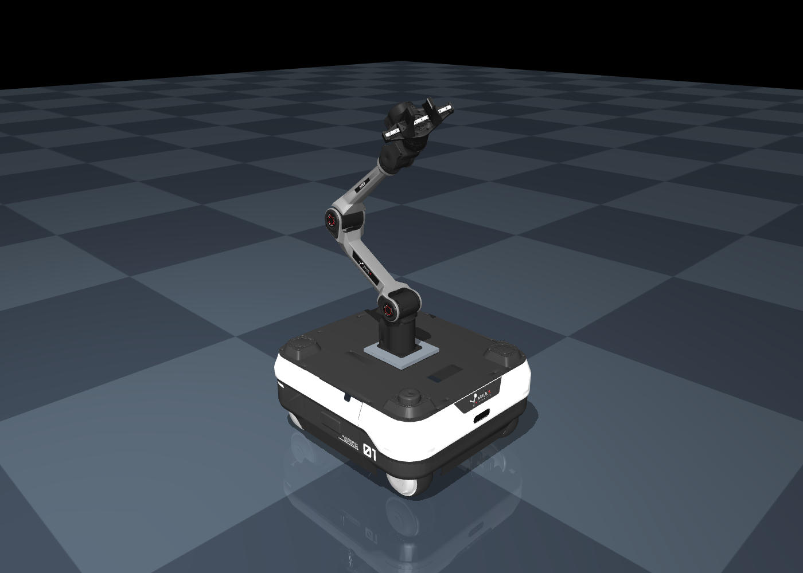

# Ranger Air + Piper X 机器人资产

Ranger Air 四轮转向底盘、Piper X 六轴机械臂和 AGX 双指夹爪，提供公共 URDF 及 Isaac Sim、MuJoCo、Gazebo 原生模型。



## 目录

| 路径 | 内容 |
|---|---|
| `common/` | `robot.urdf`、网格和关节 / 驱动参数 `robot.json` |
| `isaacsim/` | `robot.usd` 入口及其引用的 `robot.usdc` |
| `mujoco/` | `robot.xml` 本体和 `scene.xml` 最小场景 |
| `gazebo/` | SDF 模型和场景；带 `.modern` 的文件适用于新版 Gazebo |
| `examples/` | 三个平台各一个最小加载示例 |

## 模型约定

- 单位：米、千克、弧度；X 向前、Y 向左、Z 向上。
- 浮动底座，16 个可动关节：4 转向、4 轮驱动、6 机械臂、2 夹指。
- 参考臂姿态：`piper_joint1..6 = [0, 0.6, -1.2, 0, 0.6, 0]`。
- 夹爪总开口 0–0.10 m，默认 0.04 m；两指目标为 `opening/2` 和 `-opening/2`。
- TCP 为 `piper_tcp`，相对夹爪基座沿 +Z 0.120 m。
- 传感器仅保留外观和坐标系；碰撞体、惯性及安装参数为仿真近似。

## 加载

从本目录执行，分别使用对应仿真器的 Python 环境。脚本根据自身位置寻找模型，复制时保留目录结构。

MuJoCo（安装 `mujoco`）：

```bash
python examples/load_mujoco.py
python examples/load_mujoco.py --headless --steps 1500
```

Isaac Sim（使用其 Python 环境，或将 `python` 替换为官方 `python.sh`）：

```bash
python examples/load_isaacsim.py
python examples/load_isaacsim.py --headless --steps 1500
```

Gazebo（安装对应发行版及 `ign` / `gz` 命令）：

```bash
python3 examples/load_gazebo.py --family fortress
python3 examples/load_gazebo.py --family fortress --headless --iterations 5000
python3 examples/load_gazebo.py --family modern
```

示例加载机器人并保持参考姿态。Gazebo 使用临时场景解析资源路径，原生控制器从零位运动到参考姿态，约需 4 秒仿真时间。控制接口为 `/ranger_piper/<joint_name>/command`，位置关节目标用 rad / m，轮速目标用 rad/s。

## 协作与兼容

参考运行版本：MuJoCo 3.9.0、Isaac Sim 5.1.0.0、Gazebo Fortress 6.18.0。新版 Gazebo 适配尚未运行验证；Gazebo Classic 需另行适配。跨大版本可能需要调整 API / 插件，旧版 MuJoCo 可能不支持 MJCF 中的 `mesh inertia="shell"` 属性。

公共模型和三平台模型分别保存。修改几何、关节或驱动时，应同步对应文件及 `common/robot.json`。USD 入口和 payload 需一起保留；MuJoCo / Gazebo 引用 `common/meshes/`。跨平台的接触与驱动响应可能不同。
